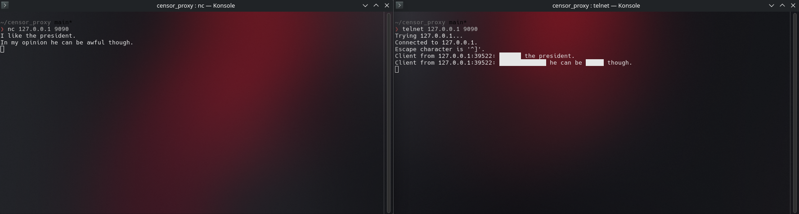
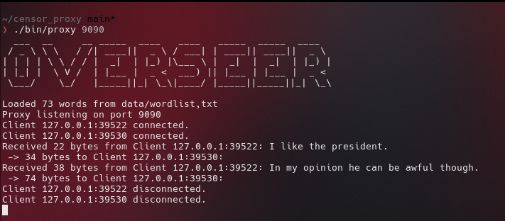
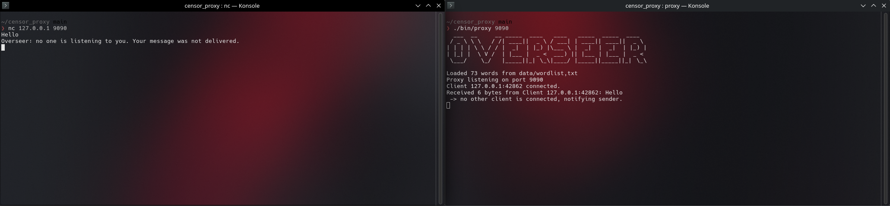

# Censor Proxy

## Description
A proxy server (called the Overseer) saves users from offensive language!
When a client connects to the server, messages are delivered to **one** other client, free from offensive language.

## Demo

*Left client sends messages to the right client. The right client receives it with the offensive words censored.*

*The Overseer logging connections and the bytes forward between clients.*

*If no other client is connected, the Overseer tells the sender their message wasn't delivered.*

## Why I built this
The Overseer is a joke with a point. Over the last several years, offensive or non-politically correct
language has been a large topic of discussion. Here, I offer my solution with some tongue and cheek.
Instead of censoring coarse language or slurs which you may expect after reading the description,
all opinion words are blocked. Most real-world censorship works in a similar way. The code is a
circular-buffer chat relay in C; my commentary is the wordlist. Practically, this was a small project
for me to learn about socket programming.

## Installation
1. Clone the repository
2. In project root type `make`

## Usage

### Step 1: Starting the Overseer
In project root directory:
`./bin/proxy 9090` (or another free port you desire)

### Step 2: Connecting as a client

In another terminal there are a few ways you can connect interactively.

Netcat:
`nc 127.0.0.1 9090`

Telnet:
`telnet 127.0.0.1 9090`

socat:
`socat - TCP:127.0.0.1:9090`

## Limitations

1. No authorisation and encryption.
2. Tested on Linux only.
3. Messages are limited to only two users.
4. Has not undergone stress testing.
